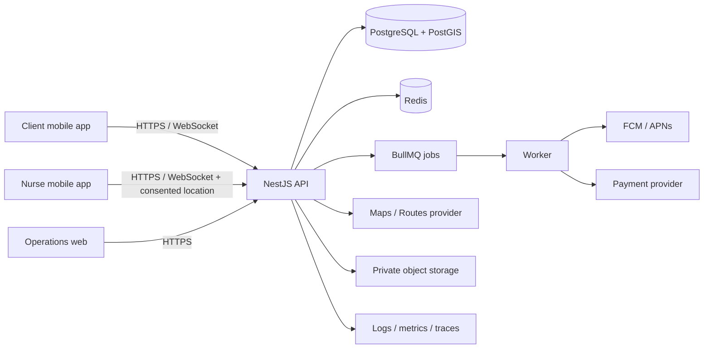

# Uber for Nurses Ghana — System Design

**Product scope:** A two-sided marketplace for families to book vetted nurses for home care. Nurses set availability and service areas; eligible nearby nurses receive a visit offer simultaneously, and the first valid acceptance wins.

**Status:** Architecture proposal for an MVP. Regulatory classification, clinical scope, fees, payment provider availability, mapping coverage, and data residency must be confirmed before launch.

## 1. Product definition

### Actors

- **Client / family:** creates a request, provides care context and location, pays, follows the booking, rates service, and can contact support.
- **Nurse:** completes onboarding and credential checks, configures skills/service areas/availability, receives nearby offers, accepts or declines, navigates, records visit status, and receives payout.
- **Operations / clinical admin:** approves credentials and service types, handles disputes and incidents, monitors dispatch, suspends accounts, and audits changes.

### Initial service boundary

Begin with scheduled, non-emergency home visits in a compact Greater Accra service area. Define a catalog of nurse-delivered services with scope, expected duration, prerequisites, and price. Do not represent the service as an emergency response service. Requests that indicate an emergency should display local emergency guidance and a contact path, not enter ordinary dispatch. Clinical protocols and escalation routes must be reviewed by a Ghana-licensed clinical lead.

### Core product rules

1. A nurse can go online now or publish future availability blocks.
2. A visit is matched only to active, verified nurses with valid credentials, matching skills, no schedule conflict, and a service area covering the visit.
3. Send the same offer to a bounded nearby cohort at once. First valid acceptance wins atomically; all other offers close.
4. Offer details are minimized before assignment. Share exact address and patient details only after assignment and when needed for care.
5. Every booking, offer, status transition, credential approval, payment, and safety incident is auditable.

## 2. Recommended stack

| Layer | Recommendation | Why |
|---|---|---|
| Mobile apps | React Native + Expo + TypeScript; separate client and nurse app shells or role-based apps from a shared package | One team can ship Android and iOS; nurse app can use native location and push integrations where needed. Treat continuous background location as optional and consent-based, not a requirement for being online. |
| Operations web | Next.js + TypeScript | Fast internal console for credential review, dispatch visibility, customer support, and configuration. |
| API | NestJS + TypeScript, REST + Socket.IO/WebSocket gateway | Modular monolith supports clear domain boundaries; WebSocket for live offers and booking updates. |
| Database | Managed PostgreSQL with PostGIS | Transactions for bookings and race-safe acceptance; geospatial indexes for nearby candidate search; SQL remains portable. |
| Cache / jobs | Redis + BullMQ | Offer expiry, retryable notifications, scheduled reminders, and rate limiting. Keep PostgreSQL as source of truth. |
| Realtime | Socket.IO rooms backed by Redis adapter; push via FCM/APNs through Expo or direct provider | Live foreground offers plus push wake-up when app is backgrounded. Push delivery is best-effort; clients must refresh from API. |
| Maps / routing | Google Maps Platform: Places/Geocoding and Routes API; isolate behind a `MapsProvider` interface | Route Matrix can estimate travel time between a nurse cohort and the home; cache estimates and use a configurable fallback. Verify Ghana address/landmark quality and cost during pilot. |
| Payments | Provider adapter; evaluate Paystack and Hubtel for Ghana mobile money/cards, settlement, refunds, and split payouts | Provider choice depends on marketplace/split-settlement support, business onboarding, fees, and current terms. Do not hardwire provider semantics into bookings. |
| File storage | S3-compatible private object storage for credential documents | Private buckets, short-lived signed URLs, malware scanning, retention controls. |
| Observability | OpenTelemetry + managed logs/metrics/error tracking | Trace dispatch and payment lifecycle; alert on offer failures, delayed jobs, and stuck bookings. |
| Infrastructure | Docker; managed container service and managed PostgreSQL/Redis in a Ghana-appropriate region where available | Keep operations small initially; avoid operating Kubernetes until scale requires it. Confirm provider region, backups, transfer safeguards, and applicable Ghana requirements. |
| CI/CD | GitHub Actions, type/lint/build checks, database migration checks, staged mobile releases | Predictable releases and rollback path. |

**Why not start with a pure no-code backend:** simultaneous acceptance needs transactional locking, robust retries, auditability, and geospatial querying. A managed PostgreSQL service is still a reasonable way to reduce infrastructure work, but dispatch-critical logic should live in the API and database transaction boundary.

### Suggested deployment shape

Start with one NestJS API deployment, one worker deployment from the same codebase, managed PostgreSQL/PostGIS, Redis, object storage, and a separate Next.js admin. Use separate development, staging, and production environments. Modular monolith first; extract dispatch or payments only when measured load or team ownership justifies it.

## 3. High-level architecture



The database is authoritative. Socket and push messages notify clients of changes; they are not proof that a booking or payment changed state.

## 4. Main modules

- **Identity & access:** phone OTP, session/device management, role-based authorization, account suspension.
- **Nurse profile & verification:** identity, N&MC credential number/status/expiry, scope, skills, experience, references, document review. Store document access separately from public profile data.
- **Availability & location:** online state, future blocks, heartbeat/last-seen, opt-in location updates while online, service zones and travel radius.
- **Service catalog:** approved services, eligible nurse cadres/skills, duration, price rules, contraindications and escalation text.
- **Requests & bookings:** request intake, quoting, booking state machine, cancellation/no-show policy, visit check-in/out.
- **Dispatch:** eligibility, geo search, cohort selection, offer fan-out, expiration, acceptance arbitration, widening/retry.
- **Payments & payouts:** authorization/capture/refund/reconciliation, nurse earnings ledger, payout status.
- **Messaging & notifications:** push, SMS fallback, in-app events, masked contact where feasible.
- **Safety & support:** emergency flag handling, incident report, escalation, support notes, immutable audit trail.
- **Admin & analytics:** credential queue, dispatch monitor, refunds, service configuration, operational metrics.

## 4A. Client (family) side product design

The client app is for the person arranging care, who may be a relative rather than the patient. Keep the primary action obvious: choose a visit, select when and where, review the price, and request a nurse. Use reassuring plain language, show what the service can and cannot provide, and avoid making the app feel like a substitute for emergency services.

### Client app navigation

Bottom tabs for the MVP:

- **Home:** request care, active booking card, upcoming visits, and emergency guidance.
- **Bookings:** upcoming, active, completed, cancelled; visit receipts and rebooking.
- **Family:** saved patients/people receiving care and authorized family members (can be deferred).
- **Account:** phone/profile, language, payment methods, support, privacy controls, terms.

If scope is very tight, use Home, Bookings, and Account; put patient and payment details in the booking flow.

### Client booking screens and sequence

1. **Welcome / sign in:** Ghana phone number, OTP verification, clear consent to terms and privacy notice. Do not require profile details before the user can understand the service.
2. **Home / choose care:** service cards with plain-language descriptions, duration, indicative price, eligibility and exclusions. “Request a nurse” is the main CTA. Emergency banner routes out of standard dispatch.
3. **Who needs care?:** patient name or chosen display name, age band (only if needed), relationship, and a small amount of care context. Collect detailed health data only when required for the selected service and explain why.
4. **Visit details:** service type, preferred date/time or “as soon as possible” if supported, visit duration, access instructions, and optional accessibility/language preferences.
5. **Location:** map pin plus GhanaPost GPS/address where available, neighborhood/landmark, directions, and a contact phone. Let the client correct the pin and include a call-on-arrival instruction. Never assume a postal address is sufficient.
6. **Review & quote:** service, time window, location summary, travel fee if any, total in GHS, cancellation terms, and what happens after the request. Explicit submit action.
7. **Finding a nurse:** progress states with cancel option and a realistic message that nearby eligible nurses are being notified. Do not expose nurse names/locations before assignment.
8. **Nurse confirmed:** nurse display name, verified status, relevant experience/skills, approximate ETA or scheduled arrival, visit summary, call/chat support, cancellation policy, and share-booking option.
9. **Visit in progress / complete:** status updates, arrival confirmation, receipt, feedback, issue reporting, and repeat booking.

### Client-side booking states and copy intent

| State | Client sees | Available action |
|---|---|---|
| Draft | Service and details being prepared | Edit or discard |
| Quoted | Itemized amount and visit terms | Confirm request or edit |
| Searching | “We’re notifying nearby nurses” and progress; no false countdown guarantee | Cancel or contact support |
| Assigned | Nurse profile and confirmed visit time/ETA | Message/call support, view details, cancel under policy |
| En route | Last update time and ETA when available | Call support; update access instructions |
| Arrived | Arrival confirmation and visit PIN option | Confirm nurse arrival / contact support |
| In progress | Visit status and support access | Report an urgent concern |
| Completed | Receipt, rating, rebook, report issue | Rate, rebook, contact support |
| No nurse found | Honest explanation and next available option | Try another time, widen service area if user agrees, request callback |
| Cancelled / disputed | Reason, fee/refund status, support path | Contact support |

Realtime updates are advisory. On app resume, refresh the booking from the API; do not rely only on socket events or push notifications. Make every action retry-safe and show the last update time if offline.

### Client privacy and trust UX

- Explain why each requested health detail is needed and make nonessential fields optional.
- Obtain separate permission for precise location; allow manual pin/landmark entry if permission is denied.
- Collect the visit destination for the booking, not continuous client tracking.
- Before assignment, share only the general area and service summary needed for a nurse to decide; reveal exact address and minimum necessary care instructions to the assigned nurse.
- Show credential verification status and support availability; do not promise clinical outcomes or guaranteed arrival time.
- Make emergency guidance visible in request flow and active visit support. Clearly distinguish routine home care from emergency response.
- Provide an accessible flow: readable text, large tap targets, plain language, low-data screens, and support for a family member booking on behalf of someone else.

### Client app technical structure

```text
apps/client-mobile/src/
├── app/                            # Expo Router routes and layouts
│   ├── (auth)/                     # Phone and OTP
│   ├── (tabs)/                     # Home, bookings, account
│   ├── request/                    # Service, patient, schedule, location, review
│   ├── booking/[bookingId]/        # Searching, assigned, visit, completion
│   └── support/                    # Help, contact, issue report
├── features/
│   ├── auth/
│   ├── home/
│   ├── service-catalog/
│   ├── care-request/
│   ├── location-picker/            # Pin, landmark, GhanaPost GPS, permission UX
│   ├── quote-and-payment/
│   ├── booking-status/              # State machine view + realtime refresh
│   ├── family-profiles/
│   ├── feedback/
│   └── support/
├── components/                     # Client-specific UI
├── navigation/
├── services/                       # API, socket, push, maps adapters
├── state/                          # Session and request draft; avoid caching health data broadly
├── hooks/
├── theme/
├── localization/
└── utils/
```

Use Expo Router, TanStack Query for server state, React Hook Form + Zod for forms/contracts, and a small local store (e.g. Zustand) only for transient UI/request drafts. SecureStore holds refresh/session secrets; never put tokens or sensitive patient details in ordinary AsyncStorage, crash logs, analytics, or push payloads. Cache only the minimum required data and clear sensitive booking context on logout. Add crash/error reporting with redaction enabled.

### Client app MVP acceptance criteria

- A family member can request a supported visit with a reliable location pin and landmark, review a transparent GHS quote, and submit without double booking on retries.
- The app clearly distinguishes searching, assigned, no nurse found, cancellation, and completion; after network loss it reconciles with server state.
- Once a nurse accepts, the client sees only the assigned nurse's approved profile fields and the appropriate contact/support options.
- The user can cancel or report an issue, understand any refund/cancellation result, and receive a receipt.
- No emergency claim, exact address, diagnosis, or patient name appears in push notification previews or analytics.
- The complete request can be made with location permission denied by entering a pin/landmark manually, and works on a slow connection with retry-safe submission.

## 5. Dispatch design

### Candidate eligibility

For a request with service `S`, location `L`, and time window `T`, select nurses who satisfy all of these:

- account and professional credential are approved and not expired/suspended;
- nurse has the required skill/cadre for `S`;
- nurse is online for immediate jobs or has an available future block covering `T`;
- no overlapping accepted booking, travel/buffer time, or blocked period;
- nurse has opted into the relevant service zone and is inside the configured search radius;
- recent location heartbeat exists for immediate requests; otherwise use the nurse's declared base/service zone and label ETA as approximate.

First query PostGIS by geospatial radius using the nurse's latest permitted location. Then rank a small candidate set by route ETA, workload/fairness, reliability, and customer preferences. Road ETA is more useful than straight-line distance. Do not let a ranking score override hard eligibility or license status.

### Simultaneous offer algorithm

1. In a DB transaction, create the request/booking intent and reserve any payment authorization if the payment model requires it.
2. Query eligible nurses and choose a bounded cohort (for example, nearest 5–10; tune with pilot data and notification cost).
3. Create one `dispatch_round` and one `offer` row per nurse with a short expiry. Persist before sending notifications (transactional outbox pattern).
4. Deliver real-time socket event to connected nurse; enqueue push/SMS fallback. Offer screen has a server-enforced countdown.
5. On accept, execute a transaction: lock dispatch round and booking rows, verify offer is still open/unexpired and nurse still eligible, transition booking to assigned, close all sibling offers, create assignment, and write audit/outbox events. A unique constraint on active assignment per booking plus row locking prevents two winners.
6. If all offers expire/decline, start next wider radius/cohort, or ask client to choose another time. Limit rounds and report no availability clearly.
7. If winner cancels before service, re-dispatch if policy allows; do not silently keep old offer set active.

**Important:** “first accept” means first valid acceptance committed by the server, not the earliest phone tap. Idempotency keys make repeated taps safe.

### Availability semantics

- `ONLINE_NOW`: nurse can receive immediate offers; availability expires if heartbeat is stale or nurse toggles offline.
- `SCHEDULED_BLOCK`: local-time recurring or one-off windows, stored in UTC with the nurse's IANA time zone.
- `BUSY`: accepted booking and configurable travel/turnover buffer.
- `OFFLINE`: no immediate offers; scheduled blocks remain available if nurse wants future bookings.

Offer and assignment logic must account for appointment duration, travel time, buffer, and overlapping bookings.

## 6. Data model (initial)

Core tables (UUID primary keys, timestamps, soft deletion only where legally appropriate):

- `users(id, phone_e164, role, status, created_at)`
- `client_profiles(user_id, display_name, preferred_language)`
- `nurse_profiles(user_id, public_name, cadre, credential_number, credential_status, credential_expiry, home_point, service_radius_km, timezone, rating_summary)`
- `nurse_documents(id, nurse_id, object_key, document_type, review_status, reviewed_by, retention_until)`
- `nurse_skills(nurse_id, service_id, verified_at)`
- `availability_blocks(id, nurse_id, starts_at, ends_at, status, source)`
- `nurse_presence(nurse_id, online, last_seen_at, location geography(Point,4326), location_updated_at)`; strict retention and access limits
- `service_catalog(id, code, name, description, duration_minutes, eligibility_rules, active)`
- `care_requests(id, client_id, service_id, scheduled_start, location geography(Point,4326), address_private, landmark, care_summary_private, status)`
- `bookings(id, request_id, nurse_id, status, quoted_amount, currency, starts_at, ends_at, accepted_at, checked_in_at, checked_out_at)`
- `dispatch_rounds(id, booking_id, sequence, radius_km, status, expires_at)`
- `offers(id, round_id, nurse_id, status, offered_at, expires_at, responded_at)` with unique `(round_id,nurse_id)`
- `payments(id, booking_id, provider, provider_reference, amount, currency, status)`
- `ledger_entries(id, booking_id, party, amount, currency, entry_type, created_at)`
- `incidents(id, booking_id, category, severity, status, restricted_details)`
- `audit_events(id, actor_id, entity_type, entity_id, action, metadata_redacted, created_at)`
- `outbox_events(id, event_type, aggregate_id, payload, published_at, created_at)`

Use PostGIS GiST index on current nurse point and request point; B-tree indexes on status/time and foreign keys. Keep health details out of logs, analytics, push payloads, and broad admin access. Encrypt backups and sensitive fields; store only data needed for service delivery.

## 7. API and event outline

REST examples (version under `/v1`):

- `POST /auth/otp/request`, `POST /auth/otp/verify`
- `POST /nurses/onboarding`, `POST /nurses/documents`, `GET /nurses/me/verification`
- `PUT /nurses/me/availability`, `POST /nurses/me/location` (online and permissioned only)
- `GET /services`, `POST /care-requests/quote`, `POST /care-requests`
- `GET /bookings/:id`, `POST /bookings/:id/cancel`, `POST /bookings/:id/check-in`, `POST /bookings/:id/check-out`
- `POST /offers/:id/accept` and `POST /offers/:id/decline` (idempotent)
- `POST /payments/webhooks/:provider` (signature validation, replay protection)
- Admin endpoints scoped by permission and recorded in audit log.

Socket events: `dispatch.offer.created`, `dispatch.offer.closed`, `booking.assigned`, `booking.status.changed`, `chat.message.created`. Every event includes event ID, entity ID, version, and timestamp; clients fetch authoritative state after reconnect.

## 8. Booking and payment state

Suggested booking states:

`DRAFT → QUOTED → SEARCHING → ASSIGNED → EN_ROUTE → ARRIVED → IN_PROGRESS → COMPLETED`

Terminal alternatives: `CANCELLED`, `NO_NURSE_FOUND`, `EXPIRED`, `DISPUTED`.

Payment lifecycle should be separate: `PENDING → AUTHORIZED → CAPTURED → REFUNDED/PARTIALLY_REFUNDED` with provider webhooks as source of payment confirmation and reconciliation jobs for missed webhooks. Do not mark a booking paid from a mobile redirect alone.

## 9. Security, privacy, and clinical safety

- Verify nurse identity and current N&MC registration before activation; re-check expiry and maintain human review/audit.
- Determine with Ghana counsel/N&MC/HeFRA whether platform, home-care service, clinical governance, insurance, and facility rules apply to the selected operating model.
- Register with Ghana's Data Protection Commission as applicable before processing; document lawful purpose, consent, retention, access, processor contracts, breach handling, and cross-border transfers.
- Separate account/contact data from health data; least-privilege roles; MFA for staff; short-lived signed document URLs; secrets in managed secret store.
- Minimize nurse location collection: collect only while nurse explicitly online/working, show status clearly, stop collection offline, limit retention, and restrict access. Avoid always-on background tracking.
- Never include patient names, diagnoses, or precise addresses in push notification text or analytics events.
- Check-in/out can use a one-time client PIN or proximity with consent; geofencing alone should not prove care occurred.
- Define safeguarding, consent/capacity, medication handling, infection prevention, incident escalation, complaint handling, insurance, and emergency referral protocols with clinical counsel.
- Use rate limits, device/session revocation, OTP abuse controls, webhook signatures, encryption in transit/at rest, dependency scanning, and security incident procedures.

## 10. Ghana-specific product considerations

- Mobile-first, Android-first device testing; low-data screens and retry-safe actions for intermittent connectivity.
- Use phone OTP and local number normalization; support English first and assess Twi/Ga/Dagbani language needs with users.
- Support mobile money and cashless receipts; confirm provider settlement/payout and refund capabilities before selecting one.
- Addresses may rely on landmarks and phone directions; collect a map pin plus landmark and call-instructions field. Validate maps and routing quality in the target neighborhoods.
- Display Ghana cedi (GHS), clear visit and travel charges, and transparent cancellation terms.
- Use a nurse location heartbeat only when opted in and available; if app is killed or connectivity drops, notify the nurse and make availability stale rather than promising a live ETA.

## 11. Reliability and operations

- API requests use idempotency keys for request creation, accept/decline, and payment initiation.
- Outbox pattern ensures DB commit and notification enqueue do not diverge.
- Workers retry transient failures with backoff; dead-letter and alert after bounded retries.
- Redis loss must not create duplicate winners; PostgreSQL transaction/constraints arbitrate acceptance.
- Backups with point-in-time recovery; test restoration; documented incident response and manual dispatch fallback.
- Admin dashboard exposes stuck requests, offer delivery/acceptance funnel, stale nurse availability, payment webhook lag, cancellations, and support queue.

## 12. MVP release plan

### Phase 0 — validate operating model

Confirm target neighborhood and service catalog, clinical lead, licensing path, payment and payout feasibility, nurse verification workflow, pricing, cancellation rules, emergency policy, data-protection obligations, insurance, and support coverage. Interview families and nurses; do not infer willingness to pay from app downloads.

### Phase 1 — controlled MVP

- Client: sign-in, service selection, location/landmark, scheduled request, quote, payment or approved pilot payment method, booking status, support.
- Nurse: onboarding, credential status, skills, service zone, online toggle, availability calendar, simultaneous job offer, accept/decline, booking checklist.
- Operations: credential approval, live request/offer view, manual assignment/cancel/refund, incident queue, audit history.
- Backend: transactional dispatch, push + WebSocket, booking state machine, payment adapter, privacy boundaries, metrics.

Start with a limited service area, limited daily request volume, human dispatch oversight, and a small cohort of verified nurses. Validate the workflows before expanding zones or adding high-risk services.

### Phase 2 — scale proven workflows

Improve ETA, fair dispatch rotation, scheduled recurring care, family accounts, nurse payouts, multilingual UX, service-zone expansion, quality analytics, and partner integrations. Split services only when operational evidence calls for it.

### Explicitly defer

AI clinical triage, emergency dispatch, complex EHR integration, medication prescribing, automatic credential decisions, surge pricing, nationwide launch, and multi-service microservices.

## 13. Success metrics

- Request-to-assignment rate and median time to assignment
- Offer delivery, open, accept, expiry, and decline rates by cohort and time of day
- Booking completion, cancellation, no-show, rebooking, and complaint rates
- Nurse utilization, earnings per active hour, travel time, and offer fairness
- Contribution margin per completed visit after nurse pay, payment fees, refunds, support, and travel subsidies
- Credential verification turnaround and expiry compliance
- Safety incidents per visit and incident response time
- Patient repeat rate and family trust score

## 14. Proposed repository structure

```text
uber-for-nurses/
├── apps/
│   ├── client-mobile/              # Expo client/family app
│   ├── nurse-mobile/               # Expo nurse availability and dispatch app
│   ├── ops-web/                    # Next.js internal operations console
│   ├── api/                        # NestJS REST + WebSocket API
│   └── worker/                     # Queue processors, notifications, reconciliation
├── packages/
│   ├── api-client/                 # Generated/typed API client
│   ├── contracts/                  # Zod schemas, DTOs, event contracts
│   ├── domain/                     # Shared enums, value objects, pure rules
│   ├── ui-mobile/                  # Shared mobile components/tokens
│   ├── ui-web/                     # Shared web components
│   ├── config/                     # ESLint, TypeScript, prettier, build config
│   └── test-fixtures/              # Non-sensitive fixtures and factories
├── infrastructure/
│   ├── docker/                     # Local dependencies and images
│   ├── terraform/                  # Cloud resources (when selected)
│   ├── monitoring/                 # Dashboards and alert definitions
│   └── runbooks/                   # Deploy, restore, incident, manual dispatch
├── database/
│   ├── migrations/
│   ├── seeds/                      # Synthetic development data only
│   └── policies/                   # SQL constraints, indexes, access policies
├── docs/
│   ├── adr/                        # Architecture decision records
│   ├── product/                    # Service catalog, journey, operating policies
│   ├── api/                        # OpenAPI and event schemas
│   ├── clinical-safety/            # Restricted operational protocols
│   └── privacy-security/           # Data map, retention, threat model
├── scripts/
├── .github/workflows/
├── .env.example                    # Placeholders only; no secrets
├── package.json
├── pnpm-workspace.yaml
├── turbo.json
└── README.md
```

### API module layout

```text
apps/api/src/
├── main.ts
├── app.module.ts
├── common/                         # Auth guards, errors, logging, idempotency
├── config/
├── modules/
│   ├── auth/
│   ├── users/
│   ├── nurses/                     # Profile, credential review, skills
│   ├── availability/               # Blocks, presence, location permissions
│   ├── services/                   # Catalog and eligibility rules
│   ├── requests/                   # Quotes and care requests
│   ├── dispatch/                   # Candidate search, rounds, offer arbitration
│   ├── bookings/                   # State machine, check-in/out
│   ├── payments/                   # Provider adapters, webhooks, ledger
│   ├── notifications/              # Outbox, push, SMS
│   ├── incidents/
│   ├── admin/
│   └── audit/
└── infrastructure/                 # DB, Redis, maps, storage, payment adapters
```

Each module owns its controllers, application services, domain rules, persistence queries, and DTO mapping. Avoid cross-module table writes; use application interfaces/events and database transactions where invariants span modules.

## 15. Key decisions to record before coding

1. Is the company an introducer/marketplace, employer/agency, or provider of clinical services? Get Ghana-specific legal advice.
2. Which exact visit types and nursing cadres are permitted for pilot?
3. Which launch neighborhoods and maximum travel time?
4. What does “available” mean when a nurse is offline, app is killed, or phone has no data?
5. Offer cohort size, response window, and fallback policy from pilot evidence.
6. Payment authorization/capture timing, nurse payout timing, refunds, and cash policy.
7. Patient record contents, retention periods, data-controller/processor roles, hosting region, and cross-border vendors.

## 16. Uber-inspired experience and public-pattern implementation

This section distinguishes **publicly documented Uber patterns** from the proposed Ghana implementation. Uber's current private dispatch source code, model weights, thresholds, operational rules, and full production stack are not public. This design does not claim to reproduce Uber's exact algorithm.

### Publicly documented patterns used here

- Uber's public engineering material describes a multi-sided real-time marketplace, hyperlocal geospatial indexing using H3, matching/dispatch, ETA and routing, and forecasting. H3 is an open-source hierarchical hexagonal geospatial index created by Uber. Use it as a spatial partitioning/indexing helper, not as a substitute for precise eligibility or route ETA.
- Uber's published rider-app architecture introduced **Riblets**, a modular structure separating routing, business logic, presentation and views. Riblets was described in a 2016 article as Uber's new rider app architecture at that time; do not assume it is the exact current internal architecture.
- Public Uber stack articles describe languages including Go, Java, Python and Node.js, and internal infrastructure such as Kafka and Schemaless. These are evidence of public historical/technical choices, not a current complete bill of materials.
- Uber has publicly described marketplace dispatch and ML platforms such as Michelangelo. The startup should not build an internal ML platform or adopt Uber-scale microservices before it has meaningful trip/visit data and engineering capacity.

### Revised stack choice to mirror public Uber choices where sensible

For a deliberate Uber-inspired implementation, use **native Swift for iOS and Kotlin for Android**, with shared domain contracts and aligned feature architecture. Use **Go** for the dispatch/API services and **Java** for operations/transaction services only if separate services are warranted; for an MVP, a Go modular monolith is simpler. Use PostgreSQL/PostGIS as the transactional booking source of truth, H3 for coarse cell-based candidate discovery, Redis for ephemeral presence/cache, and Kafka only after event volume/operational need justifies running or paying for a durable stream. Do not copy Schemaless/Cassandra as the main booking store; healthcare bookings require relational constraints and atomic assignment. Next.js/React remains suitable for the operations console.

If the founder/team has strong TypeScript/mobile experience, the prior Expo/NestJS recommendation remains a better delivery choice than rewriting into a stack the team cannot operate. The Uber-inspired architecture is a reference pattern, not a requirement to imitate every technology.

### Client app UX inspired by the rider app

The family app should echo the recognizable ride-hailing sequence while making healthcare needs clear:

1. **Map-first home:** location pin/current area, prominent “Book home care” action, service selector, and next booking card. Include a persistent emergency guidance entry, not an emergency dispatch button.
2. **Set visit:** choose service, person receiving care, time (now or scheduled where supported), short care notes, and access needs. Separate required clinical questions from optional profile fields.
3. **Confirm pickup-equivalent location:** home pin, GhanaPost GPS/landmark, phone/call-on-arrival instructions. Show the pin and an edit affordance before requesting.
4. **Upfront quote:** service duration, nurse fee, travel fee, any platform fee, total GHS, cancellation terms, and payment selection.
5. **Request animation / matching:** map-centered search state, clear cancel action and accessible text alternative. Show “finding an available nurse” rather than an unsupported precise countdown.
6. **Assigned nurse card:** verified profile, approved skills, approximate ETA/arrival window, visit details, message/call support, and share booking. Exact home address is revealed only after assignment.
7. **Live visit timeline:** nurse accepted → travelling → arrived → care started → completed. Location sharing only during the active assignment and according to explicit policy; always show last updated time and provide a text-based view.
8. **Receipt and feedback:** itemized receipt, rating with optional tags, support/report issue, and rebook.

Keep the fast, low-friction map and request interaction, clear progress, live status, and dependable cancellation/recovery behaviors associated with ride-hailing. Do not copy ride-hailing assumptions that are unsafe for healthcare: never imply instant emergency response, omit clinical consent, conceal the price, overstate ETA precision, or rank clinicians solely by proximity/rating.

### Nurse app UX inspired by the driver app

- **Go online / offline control:** large explicit toggle with explanation of location use and available service categories. Online state is visibly time-bounded by a heartbeat; no hidden always-on tracking.
- **Availability view:** today/weekly schedule, service zones, travel range, skills and visit-duration constraints; accepted appointments automatically block overlapping time plus travel/turnover buffer.
- **Incoming job card:** simultaneous offers to the eligible cohort; show service category, general neighborhood, scheduled time/estimated duration, estimated travel time, compensation, and required verified skill. Keep patient name, exact address and unnecessary health details hidden before acceptance.
- **Accept / decline:** obvious choices and server-authoritative countdown. The app immediately confirms if the nurse won the booking; if another nurse won, explain that the offer closed and keep nurse available for the next request.
- **Assigned visit:** reveal minimum necessary address and care instructions; show map/navigation, contact preferences, check-in procedure, support and safety action.
- **Visit workflow:** arrived, start, complete, structured visit checklist/notes appropriate to approved scope, incident/report issue, and earnings/receipt summary. Clinical record content requires a separately designed governance and retention policy.
- **Earnings and history:** completed visits, fees, payout status, cancellations, and transparent breakdown; do not use manipulative streaks or incentives that pressure unsafe care.

### Uber-inspired dispatch algorithm, adapted for nursing

This is a practical transparent baseline inspired by public marketplace/geospatial patterns, not Uber's proprietary implementation:

1. **Hard eligibility filter:** credential active, account approved, service/cadre skill qualified, availability covers visit duration and buffers, service area permits it, no conflicting booking, and location/presence fresh enough for immediate service.
2. **Hyperlocal candidate discovery:** map request to H3 cell; search that cell and neighboring rings, intersect with PostGIS radius and service-area constraints. H3 narrows search; exact geo distance and route ETA refine it.
3. **Travel estimate:** compute route ETA for a small candidate set using routing provider. Fall back to straight-line distance with explicit uncertainty if routing fails. Avoid expensive route matrix calls for the entire nurse pool.
4. **Offer cohort:** choose a bounded group of nearest eligible nurses; notify that cohort simultaneously. The configured cohort size and response timeout are pilot-tuned values, not copied constants.
5. **Atomic winner:** first valid acceptance transaction wins; database lock/constraint closes all sibling offers. Client and nurse receive server-confirmed assignment events.
6. **Expand search:** if no acceptance, widen H3 rings / travel radius and issue another cohort, subject to a maximum radius and client-approved travel cost/time. Stop when patient declines or no viable candidate remains.
7. **Fairness and quality guardrails:** initially rank by eligibility, ETA, availability fit, then apply a bounded rotation among similarly suitable nurses to avoid one nurse receiving all work. Later evaluate completion/reliability signals with explainable rules. Do not use clinical outcome predictions or black-box ranking for MVP.
8. **Learn from outcomes:** log candidate cohort, ETA estimates, offers, response, assignment, cancellations, completion and actual travel time with privacy controls. First improve rules via offline analysis/A-B tests; consider prediction models only with enough representative data and clinical fairness review.

### Public references

- Uber rider app architecture and Riblets (historical public article): [Engineering the Architecture Behind Uber's New Rider App](https://www.uber.com/us/en/blog/new-rider-app-architecture/)
- Uber public engineering overview: [Uber Engineering](https://eng.uber.com/)
- Uber published tech stack (historical article): [The Uber Engineering Tech Stack, Part I](https://www.uber.com/us/en/blog/tech-stack-part-one-foundation/)
- Uber on marketplace ML platform (historical public description): [Meet Michelangelo](https://www.uber.com/gb/en/blog/michelangelo-machine-learning-platform/)
- H3 open-source spatial index: [H3 documentation](https://h3geo.org/)

## References

- Google Routes API and route matrix: [Routes API](https://developers.google.com/maps/documentation/routes/), [route matrix response](https://developers.google.com/maps/documentation/routes/understand-rm-response)
- NestJS WebSocket gateways: [NestJS docs](https://docs.nestjs.com/websockets/gateways)
- Expo background task limitations/behavior: [Expo BackgroundTask](https://docs.expo.dev/versions/latest/sdk/background-task/), [Expo TaskManager](https://docs.expo.dev/versions/latest/sdk/task-manager/)
- Ghana nurse registration: [Nursing and Midwifery Council](https://nmc.gov.gh/web/registration)
- Ghana data protection obligations: [Data Protection Commission for organisations](https://dpc.gov.gh/for-organisations/), [DPC FAQ](https://dpc.gov.gh/help-faqs/)
- Facility regulation: [HeFRA](https://hefra.gov.gh/)

